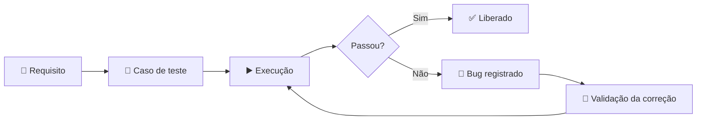

<div align="center">


<a href="https://github.com/SamuelDavi-Braga">
  
</a>

<br/>

<a href="https://www.linkedin.com/in/samuel-braga01/"></a>
<a href="https://github.com/SamuelDavi-Braga"></a>
<!-- Opcional: descomente para exibir seu e-mail publicamente
<a href="mailto:samueldavibraga01@gmail.com"></a>
-->

</div>

---

## `~/whoami`

```yaml
nome:       Samuel Davi da Silva Braga
cargo:      Analista de Testes Jr @ Grupo Otimiza
foco:       Testes funcionais · Testes não funcionais · Qualidade de software
formacao:   Engenharia de Software (Estácio) · Técnico em Desenvolvimento de Sistemas (Senac)
base_tech:  Java · Spring Boot · MySQL · HTML · CSS · Git
local:      Belo Horizonte, MG, Brasil
status:     Aprendendo todo dia 🚀
```

---

## 🧪 Como eu trabalho com qualidade



| 🔍 Atividade | 📌 O que entrego |
|---|---|
| **Testes manuais** | Execução no sistema, com foco em regras de negócio |
| **Casos de teste** | Elaboração e atualização com passos, dados e resultado esperado |
| **Gestão de bugs** | Registro, documentação e acompanhamento de bugs e não conformidades |
| **Validação de correções** | Reteste junto à equipe de desenvolvimento |
| **Melhoria de processos** | Sugestões para fortalecer a qualidade do time |

---

## 🛠️ Stack

<div align="center">


</div>

---

## 💼 Trajetória

| Período | Função | Onde |
|---|---|---|
| **fev/2026 → hoje** | Analista de Testes Jr | Grupo Otimiza |
| **fev/2025 → hoje** | Team Leader de Suporte Técnico | Grupo Otimiza |
| **jan/2024 → fev/2025** | Técnico de Suporte Jr | Grupo Otimiza |

> A experiência em liderança e suporte me deu visão de quem usa o sistema, e isso muda a forma como eu testo.

---

## 🚀 Projeto

| Projeto | Descrição | Stack |
|---|---|---|
| 📋 [**Gerenciador de Tarefas**](https://github.com/SamuelDavi-Braga/gerenciador-tarefas) | Sistema para criar, listar e excluir tarefas, com dados salvos em MySQL. Projeto Integrador da faculdade. | `Java 17` `Spring MVC` `MySQL` |

---

## 🎓 Formação e certificações

- 🎓 **Engenharia de Software**, Estácio (2025 – 2029)
- 🎓 **Técnico em Desenvolvimento de Sistemas**, Senac
- 📜 Início Rápido em Teste e QA
- 📜 Testes Automáticos + Curso Completo de Teste de Software
- 📜 Liderança e Gestão de Equipes
- 📜 Liderança de Alta Performance

---

## 📊 GitHub

<div align="center">


</div>

---

<div align="center">

**Qualidade não é etapa final, é parte de cada entrega.**

<a href="https://www.linkedin.com/in/samuel-braga01/"></a>


</div>
